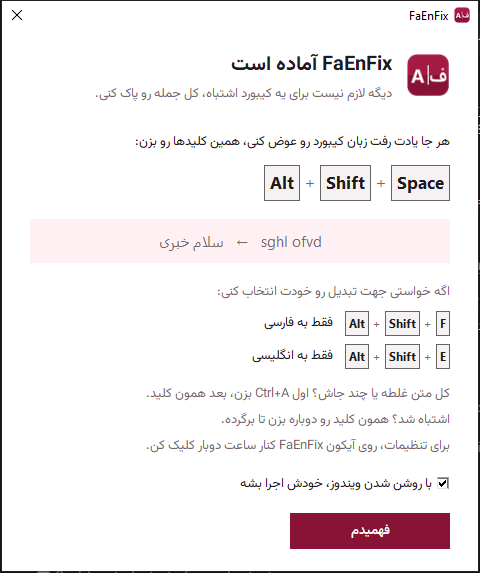
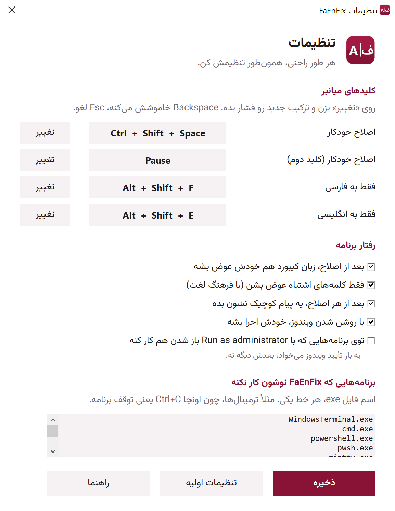

<div dir="rtl">


# FaEnFix

**یادت رفت کیبورد را عوض کنی؟ فقط یک شورتکات بزن.**

اگر به جای «سلام» نوشتی `sghl` یا به جای `hello` نوشتی «اثممخ»، FaEnFix متن را در هر برنامه‌ای درست می‌کند: تلگرام، ورد، مرورگر، VS Code و بقیه. بعد از اصلاح، زبان کیبورد هم خودش عوض می‌شود تا بقیه‌ی متن را درست تایپ کنی.

| نوشتی | بعد از شورتکات |
|---|---|
| `sghl ofvd` | سلام خبری |
| `hello sghl` | hello سلام |
| سلام `lk ldo,hl` | سلام من میخوام |
| اثممخ صخقمی | `hello world` |

<p align="center"></p>

---

## نصب (۳۰ ثانیه)

<p align="center"><a href="../../releases/latest/download/FaEnFix-Setup.exe"><b>⬇️ دانلود FaEnFix-Setup.exe</b></a></p>

1. فایل `FaEnFix-Setup.exe` را دانلود و اجرا کن، و **Install** را بزن.
2. همین! برنامه همان لحظه اجرا می‌شود و از این به بعد با روشن شدن ویندوز، بی‌صدا در پس‌زمینه بالا می‌آید.

- دسترسی ادمین لازم نیست و نیازی به نصب AutoHotkey یا هیچ چیز دیگری نیست.
- آیکونش کنار ساعت ویندوز است (اگر نمی‌بینی، روی فلش `^` کنار ساعت بزن).
- **نسخه‌ی قابل‌حمل:** اگر نصب نمی‌خواهی، از [Releases](../../releases/latest) فایل `FaEnFix.exe` را بگیر و جایی ثابت بگذار. با اولین اجرا خودش را به اجرای خودکار ویندوز اضافه می‌کند.

> **هشدار ویندوز:** چون فایل امضای دیجیتال ندارد، ممکن است SmartScreen بگوید «Windows protected your PC». روی **More info** و بعد **Run anyway** بزن. بعضی آنتی‌ویروس‌ها هم برنامه‌های AutoHotkey را اشتباهی مشکوک می‌دانند. اگر نگرانی، کد کامل در همین مخزن است و می‌توانی [خودت بسازی‌اش](#اجرا-از-روی-کد).

---

## شورتکات‌ها

| شورتکات | کار |
|---|---|
| <kbd>Ctrl</kbd>+<kbd>Shift</kbd>+<kbd>Space</kbd> یا <kbd>Pause</kbd> | تبدیل خودکار: خودش جهت را تشخیص می‌دهد |
| <kbd>Shift</kbd>+<kbd>Alt</kbd>+<kbd>F</kbd> | حتماً به **فارسی** |
| <kbd>Shift</kbd>+<kbd>Alt</kbd>+<kbd>E</kbd> | حتماً به **انگلیسی** |
| همان شورتکات خودکار، دوباره | برگرداندن آخرین تغییر |

همه را می‌توانی در تنظیمات عوض کنی.

## چطور کار می‌کند؟

**کدام متن تبدیل می‌شود؟**
- اگر متنی را **انتخاب** کرده باشی (مثلاً کل متن با <kbd>Ctrl</kbd>+<kbd>A</kbd>)، تک‌تک کلمه‌هایش بررسی می‌شوند و **هر کلمه‌ی اشتباه، هر جای متن**، درست می‌شود. یعنی اگر وسط یک پاراگراف بلند چند کلمه یا چند جمله را اشتباهی تایپ کرده‌ای، یا کل یک متن دوزبانه را برعکس نوشته‌ای، با یک شورتکات همه درست می‌شوند و بقیه‌ی متن دست نمی‌خورد.
- اگر چیزی انتخاب نکرده باشی، از مکان‌نما به عقب می‌رود تا جایی که خط (فارسی/انگلیسی) عوض شده. پس در «سلام `khl ofvd`»، کلمه‌ی «سلام» دست نمی‌خورد.
- با **فرهنگ لغت** (حدود ۴۷ هزار کلمه‌ی انگلیسی و ۳۷ هزار کلمه‌ی فارسی) هر کلمه جداگانه بررسی می‌شود: آیا خودش کلمه‌ی معناداری است، یا نسخه‌ی تبدیل‌شده‌اش؟ برای همین در `hello sghl` فقط `sghl` تبدیل می‌شود. کلمه‌ای که در هیچ‌کدام از دو فرهنگ نیست (مثل اسم‌ها) تابع کلمه‌ی کناری‌اش می‌شود.
- **محاوره‌ای هم بلد است.** فرهنگ لغت فارسی از زیرنویس فیلم‌ها ساخته شده، پس «میخوام»، «اینو»، «چیکار»، «نمیام» و امثالشان را می‌شناسد. نیم‌فاصله‌ی «می‌» و «نمی‌» هم خودش برمی‌گردد.

**کیبورد تو را می‌شناسد.** جدول تبدیل ثابت نیست؛ مستقیم از کیبوردهای نصب‌شده روی ویندوز خوانده می‌شود. پس «فارسی» قدیمی ویندوز، «فارسی استاندارد» (ISIRI 9147) و هر چیدمان انگلیسی درست کار می‌کنند.

**کلیپ‌بوردت امن است.** برنامه برای خواندن متن از کپی/پیست استفاده می‌کند، ولی بعد از کار، محتوای قبلی کلیپ‌بورد را برمی‌گرداند.

## تنظیمات

روی آیکون FaEnFix کنار ساعت دوبار کلیک کن (یا راست‌کلیک ← **تنظیمات…**).



- **شورتکات‌ها:** روی «تغییر» بزن و ترکیب کلید دلخواهت را فشار بده. <kbd>Backspace</kbd> شورتکات را خالی (غیرفعال) می‌کند و <kbd>Esc</kbd> لغو می‌کند.
- **عوض کردن زبان کیبورد بعد از اصلاح**
- **فرهنگ لغت:** اگر خاموش باشد، کل متن از ابتدای خط تا مکان‌نما تبدیل می‌شود.
- **پیام کوچک بعد از هر تبدیل**
- **اجرا با روشن شدن ویندوز**
- **کار در برنامه‌هایی که با Run as administrator باز شده‌اند:** یک بار تأیید ویندوز می‌خواهد و بعد از آن FaEnFix با دسترسی بالا بالا می‌آید.
- **برنامه‌های مستثنا:** نام فایل exe برنامه‌هایی که FaEnFix نباید در آن‌ها کار کند (اسمش را در Task Manager ← Details می‌بینی).

دکمه‌ی **تنظیمات اولیه** همه‌چیز را به حالت اول برمی‌گرداند. تنظیمات در `%AppData%\FaEnFix\settings.ini` ذخیره می‌شوند و دستی هم قابل ویرایش‌اند:

```ini
[hotkeys]
auto=^+vk20        ; Ctrl+Shift+Space   (^ = Ctrl, + = Shift, ! = Alt, # = Win)
auto2=vk13         ; Pause
to_fa=+!vk46       ; Shift+Alt+F
to_en=+!vk45       ; Shift+Alt+E
[options]
switch_layout=1
use_dictionary=1
notify=1
[apps]
exclude=WindowsTerminal.exe,cmd.exe,powershell.exe
```

## محدودیت‌ها و نکته‌ها

- **ترمینال‌ها:** در cmd، PowerShell، Windows Terminal و مشابه‌ها غیرفعال است، چون آن‌جا <kbd>Ctrl</kbd>+<kbd>C</kbd> برنامه‌ی در حال اجرا را متوقف می‌کند. در VS Code و ویرایشگرهای مشابه، FaEnFix به جای <kbd>Ctrl</kbd>+<kbd>C</kbd> از <kbd>Ctrl</kbd>+<kbd>Insert</kbd> استفاده می‌کند، پس ترمینال داخل آن‌ها هم امن است.
- **VS Code:** <kbd>Shift</kbd>+<kbd>Alt</kbd>+<kbd>F</kbd> در VS Code یعنی «Format Document». اگر به آن نیاز داری، در تنظیمات شورتکات «تبدیل به فارسی» را عوض کن.
- **برنامه‌هایی که با Run as administrator باز شده‌اند:** ویندوز اجازه نمی‌دهد برنامه‌ی معمولی به آن‌ها کلید بفرستد. گزینه‌اش را در تنظیمات روشن کن.
- کلمه‌ای که در هیچ فرهنگ لغتی نیست (مثلاً اسم خاص با حروف کوچک) ممکن است همراه کلمه‌ی کناری‌اش تبدیل شود. اگر شد، همان شورتکات را دوباره بزن تا برگردد، بعد فقط بخش اشتباه را انتخاب کن.
- فقط حروف و علامت‌های اصلی کیبورد تبدیل می‌شوند، نه حروفی که با <kbd>AltGr</kbd> تایپ می‌شوند.

## حذف

از **Settings ← Apps** ویندوز، FaEnFix را Uninstall کن. برنامه، اجرای خودکار و تنظیماتش کامل پاک می‌شوند.

نسخه‌ی قابل‌حمل: راست‌کلیک روی آیکون کنار ساعت، تیک «اجرا با روشن شدن ویندوز» را بردار و **خروج** را بزن. بعد فایل `FaEnFix.exe` و پوشه‌ی `%AppData%\FaEnFix` را پاک کن.

---

## اجرا از روی کد

1. [AutoHotkey v2](https://www.autohotkey.com) را نصب کن (یا `winget install AutoHotkey.AutoHotkey`).
2. مخزن را دانلود کن و روی `FaEnFix.ahk` دوبار کلیک کن. فرهنگ لغت‌ها در پوشه‌ی `dict` هستند.

ساخت exe روی سیستم خودت (نیاز به [Ahk2Exe](https://github.com/AutoHotkey/Ahk2Exe/releases) دارد):

```powershell
powershell -ExecutionPolicy Bypass -File tools\build.ps1
```

تست‌ها: `tests\unit.ahk` (منطق تبدیل، بیش از ۳۰ حالت) و `tests\e2e-notepad.ahk` (کلیدزدن واقعی در Notepad).

ساخت دوباره‌ی فرهنگ لغت‌ها: `tools\build-dict.ps1` — آیکون: `python tools\make-icon.py`

### انتشار نسخه‌ی جدید

با هر تگ `v*`، GitHub Actions خودش نصب‌کننده (`FaEnFix-Setup.exe`، با [Inno Setup](https://jrsoftware.org/isinfo.php)) و نسخه‌ی قابل‌حمل (`FaEnFix.exe`) را می‌سازد و در Releases می‌گذارد:

```bash
git tag v1.1.0
git push origin v1.1.0
```

## مجوز

کد تحت مجوز [MIT](LICENSE) است. فرهنگ لغت‌ها از [FrequencyWords](https://github.com/hermitdave/FrequencyWords) (بر پایه‌ی OpenSubtitles) گرفته شده‌اند و مجوز [CC-BY-SA 4.0](https://creativecommons.org/licenses/by-sa/4.0/) دارند. فونت برنامه [وزیرمتن](https://github.com/rastikerdar/vazirmatn) است، با مجوز [OFL](fonts/OFL.txt).

</div>

---

### English

**FaEnFix** fixes text typed with the wrong keyboard layout (Persian ⇄ English) in any Windows app. Download [**FaEnFix-Setup.exe**](../../releases/latest/download/FaEnFix-Setup.exe) and click Install — no admin rights needed. It starts right away and then runs silently in the background at every Windows startup. A portable `FaEnFix.exe` is also in [Releases](../../releases/latest).

- <kbd>Ctrl</kbd>+<kbd>Shift</kbd>+<kbd>Space</kbd> / <kbd>Pause</kbd>: auto-detect direction (press again to undo) · <kbd>Shift</kbd>+<kbd>Alt</kbd>+<kbd>F</kbd>: to Persian · <kbd>Shift</kbd>+<kbd>Alt</kbd>+<kbd>E</kbd>: to English
- Select any text (even Ctrl+A) and every mistyped word anywhere in it is fixed, including fully swapped bilingual text and colloquial Persian. With no selection it works from the caret back to where the script changes. Built-in dictionaries decide word by word, so `hello sghl` becomes `hello سلام`.
- Reads the mapping from your installed layouts (Persian, Persian Standard, any English layout); restores your clipboard; switches the layout afterwards.
- Everything is configurable from the tray icon → Settings (saved in `%AppData%\FaEnFix\settings.ini`).
